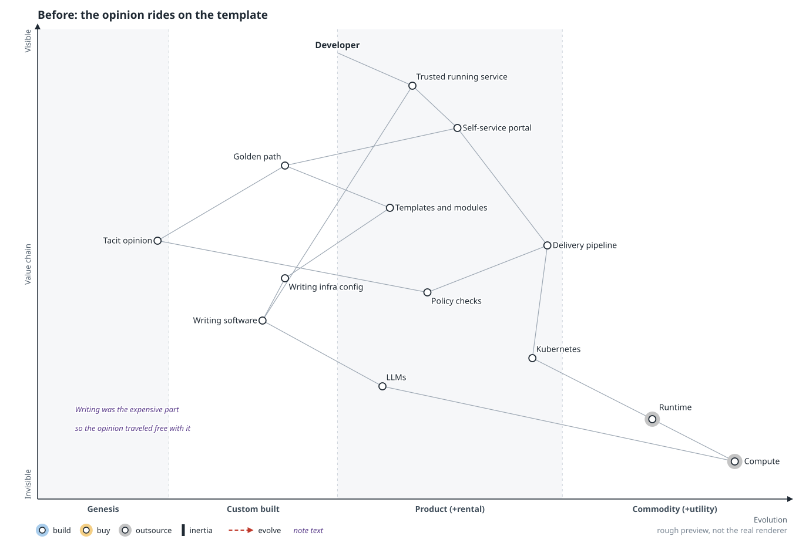
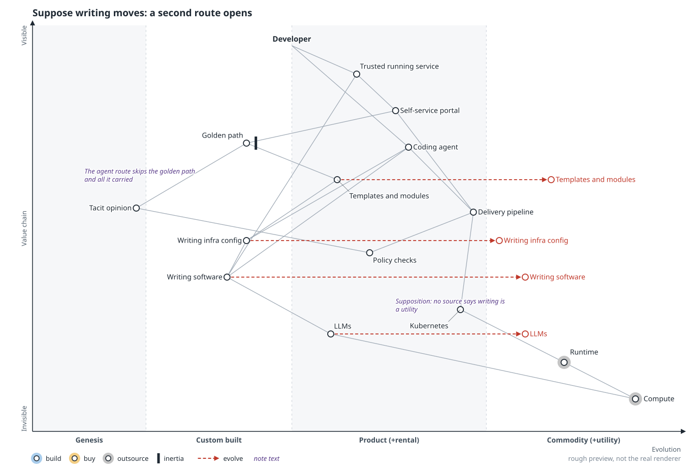
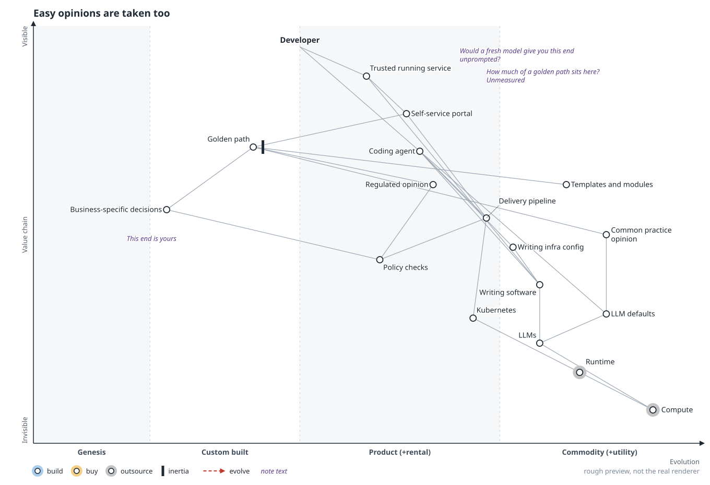
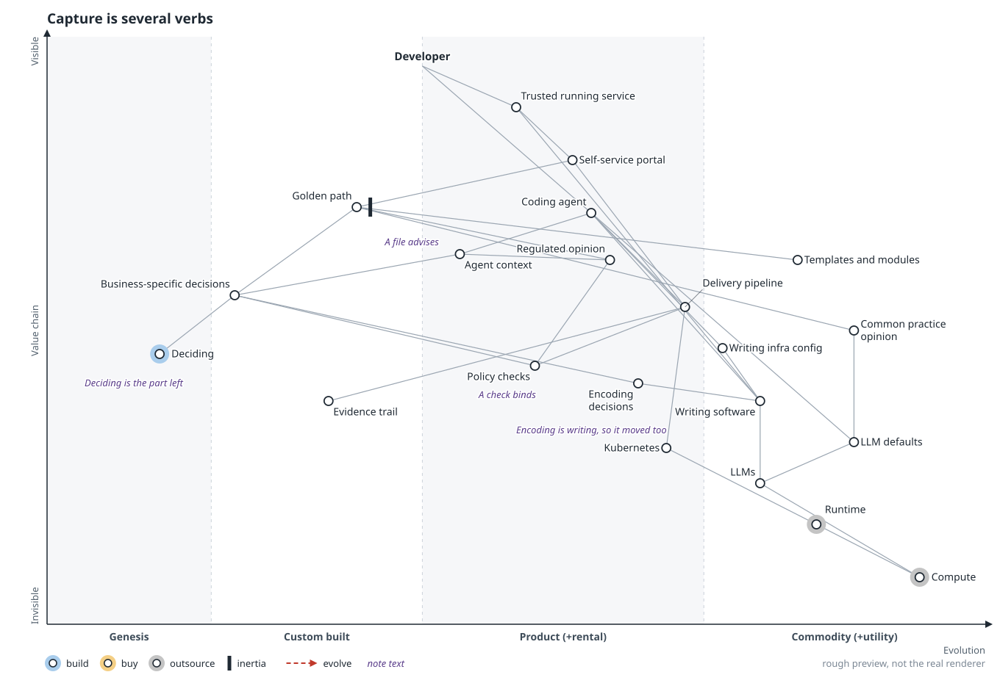
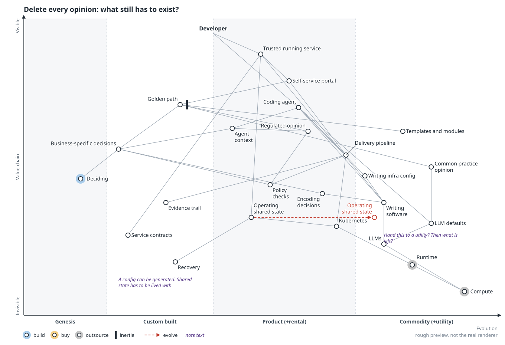
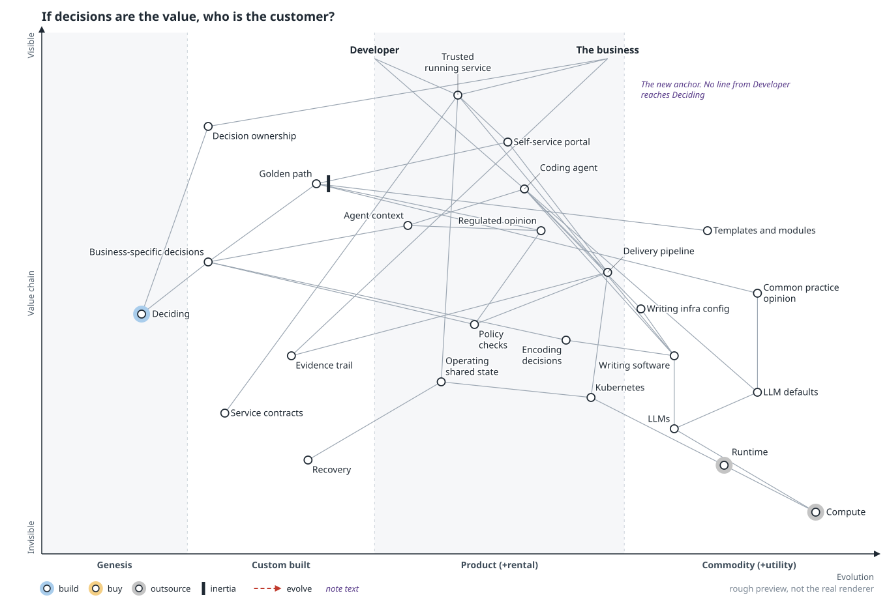
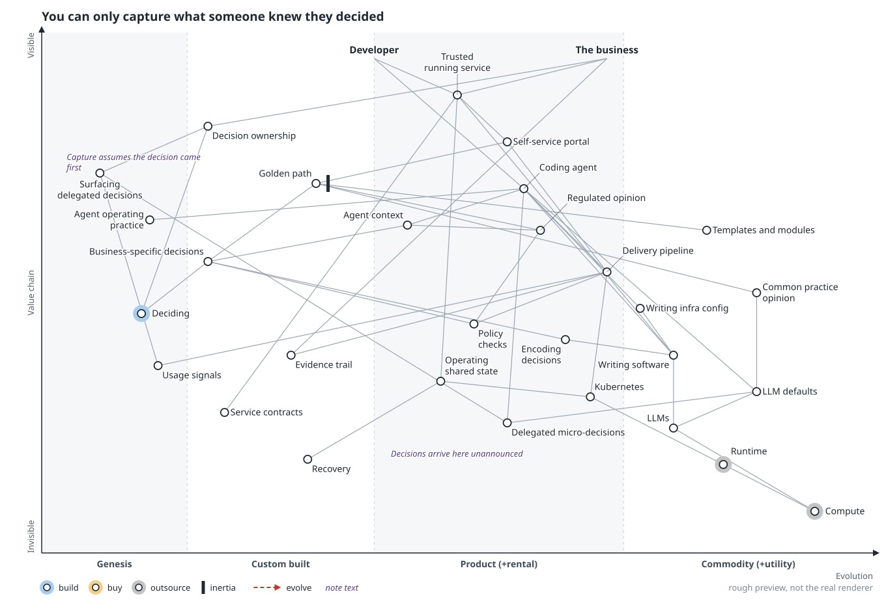
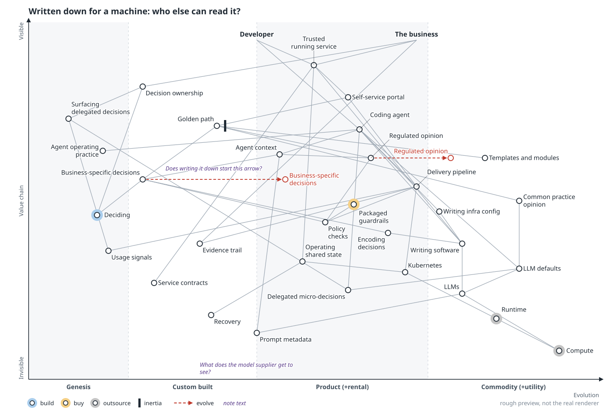

# Scenario: captured decisions

> **Starting point:** I read Steve Fenton's ["Easy is taken"](https://stevefenton.co.uk/blog/2026/10/easy-is-taken/) as writing software becoming a utility. That's my supposition; neither Fenton nor Wardley says it. This scenario only needs part of it: a cheap first draft. [All six scenarios](README.md).

**In the talk:** what’s left: *Deciding, and making decisions bind.* Much platform opinion may be generic enough that a model already knows it. What stays scarce is deciding, and agents already do some of it. **What did your agents decide last week that nobody in the company knows was decided?** (closing slide)

**Lens:** test the suggestion that a platform's value is capturing opinionated user and business needs and business decisions. No study tests it, so this is an argument from a map. Eight frames, `00` to `07`.

## Thesis

The suggestion survives in a much smaller form. Opinion traveled with the template because writing was expensive, so cheap writing breaks its delivery route. Split out, much of that opinion may be generic enough that a model already holds it.

Encoding gets cheap with everything else, and holding opinion needs only a file. What stays hard is deciding, and making a decision bind on every change, whoever wrote it. That value has a different customer from the one platform teams usually name.

The suggestion leaves out shared running state and the decisions an LLM takes unnoticed. The sequence ends on a threat it can't settle: writing the business down for a machine may let someone else have it. No map draws a component called platform.

## Frames

Follow the red highlight; tap an image to open it full size.

### 00 Before: the opinion rides on the template

**Move:** none. Anchored on the developer, the golden path delivers a saving on writing and an opinion under one name, and developers took the second to get the first.

**Question it leaves:** When a developer took your golden path, which of the two did they come for?

### 01 Suppose writing moves: a second route opens

**Move:** suppose `Writing software`, `Writing infra config` and `Templates and modules` move right. A coding agent opens a route around the golden path. Only what the policy checks already hold reaches it.

**Question it leaves:** Which of your opinions reach production only because someone used your template?

### 02 Easy opinions are taken too

**Move:** opinion splits by who else holds it: `Common practice opinion`, `Regulated opinion` and `Business-specific decisions`. `LLM defaults` appears. If a model gives the opinion unprompted, capturing it adds nothing. Nobody has data on how big each group is.

**Question it leaves:** Take your platform's ten strongest opinions and ask a fresh model. How many does it give you without being told?

### 03 Capture is several verbs

**Move:** "capture" comes apart into `Deciding`, `Encoding decisions`, `Agent context`, `Policy checks` and `Evidence trail`, each at its own stage. Encoding is writing, so it moved. A context file advises; a check binds.

**Question it leaves:** Which of your decisions still hold if nobody ever opens your portal?

### 04 Delete every opinion: what still has to exist?

**Move:** the map adds what the suggestion leaves out: `Operating shared state`, `Service contracts` and `Recovery`. Shared state gets a questioned arrow. If it completes, decisions are what remain. If it stalls, a platform lives with consequences, and opinion is one part of it.

**Question it leaves:** If a utility took everything on this side tomorrow, what would your team do on Monday?

### 05 If decisions are the value, who is the customer?

**Move:** `The business` arrives as a second anchor, with `Decision ownership` linked to `Deciding` and `Evidence trail`. No line from the developer reaches `Deciding`; the developer never asked for decisions to bind.

**Question it leaves:** If the decisions are the value, who is your customer, and have they been told?

### 06 You can only capture what someone knew they decided

**Move:** the map adds `Delegated micro-decisions`, `Agent operating practice`, `Usage signals`, and a guess in genesis, `Surfacing delegated decisions`. "Capture" assumes someone decided first. An agent takes business decisions, such as what to log and how long to keep data (Wardley's examples, 2026-10-23), with nobody in the business taking them.

**Question it leaves:** What did your agents decide last week that nobody in the company knows was decided?

### 07 Written down for a machine: who else can read it?

**Move:** `Prompt metadata` and `Packaged guardrails` appear. `Regulated opinion` gets an arrow, and `Business-specific decisions` a questioned one. A decision an agent can read is legible to whoever runs the agent, and yesterday's opinion can come back priced. The frame doesn't advise on keeping decisions private or publishing them.

**Question it leaves:** You've written the business down so a machine can read it. Who else is reading?

## Sources

- Borrowed from Simon Wardley, with IDs from my source ledger: the LLM making micro-decisions for you, and the examples in frame 06 (H01, H03, H04)
- `.owm` sources:
  [`00-before.owm`](../maps/candidates/captured-decisions/00-before.owm) ·
  [`01-writing-moves.owm`](../maps/candidates/captured-decisions/01-writing-moves.owm) ·
  [`02-whose-opinion.owm`](../maps/candidates/captured-decisions/02-whose-opinion.owm) ·
  [`03-which-verb.owm`](../maps/candidates/captured-decisions/03-which-verb.owm) ·
  [`04-delete-the-opinions.owm`](../maps/candidates/captured-decisions/04-delete-the-opinions.owm) ·
  [`05-who-owns-it.owm`](../maps/candidates/captured-decisions/05-who-owns-it.owm) ·
  [`06-decisions-nobody-took.owm`](../maps/candidates/captured-decisions/06-decisions-nobody-took.owm) ·
  [`07-who-else-reads-it.owm`](../maps/candidates/captured-decisions/07-who-else-reads-it.owm)

[All scenarios](README.md)
