# Scenario: climate

> **Starting point:** I read Steve Fenton's ["Easy is taken"](https://stevefenton.co.uk/blog/2026/10/easy-is-taken/) as writing software becoming a utility. That's my supposition; neither Fenton nor Wardley says it. This scenario runs with it, using Wardley's climatic patterns. [All six scenarios](README.md).

**Lens:** climatic patterns: co-evolution, inertia from past success, Jevons, and higher-order systems in the adjacent unexplored. Eight frames, `00` to `07`.

## Thesis

This scenario asks what the weather does to a platform and leaves strategy to others.

Suppose writing software has moved to utility. The vibe-coding developer removes one reason for a platform, the effort it saved, and the same cheapness loads everything that did not get cheaper. Past success holds the team in its old position. Practice takes years to catch up (Wardley), so a gap opens between fast technology and slow practice.

The working claim is the scenario's judgment, with no source behind it: **a platform's value right now may be whatever it does inside that gap.** Captured opinion is the best current candidate, though a poor resting place, since opinion evolves like everything else. "What's left" is a dated answer, so the sequence ends on open arrows.

No component is called platform. A platform is a fence a team draws around some components.

## In the talk

**On the closing slide:** what’s left: *The gap between fast tools and slow practice.* Cheap code loads everything that didn’t get cheaper. Practice takes years to catch up, and a platform may live in that gap, for a while. **If checking a change got as cheap as writing one, what would your platform still do?**

The talk's one worked example, cut to a single supposition: if we generate far more code, the extra weight lands on the rest of the platform, which adjusts or falls apart. These four frames are a simplified cut of frames 00, 01, 03 and 05 below, with eight or nine components instead of about twenty-five. Their `.owm` files are in [`deck/maps/`](../deck/maps/).

**1. A platform, before the supposition** ([`01-before.owm`](../deck/maps/01-before.owm))

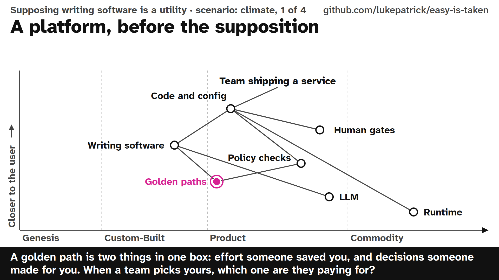

A golden path is two things in one box: effort someone saved you, and decisions someone made for you. When a team picks yours, which one are they paying for?

**2. Suppose writing software moves** ([`02-suppose-writing-moves.owm`](../deck/maps/02-suppose-writing-moves.owm))

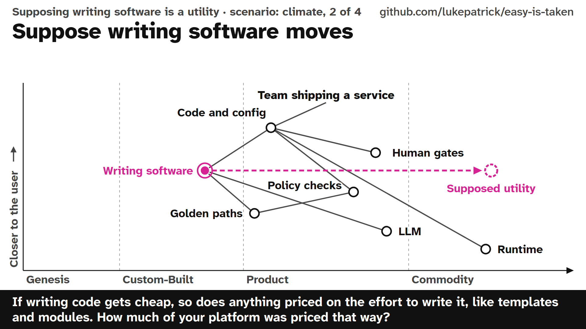

If writing code gets cheap, so does anything priced on the effort to write it, like templates and modules. How much of your platform was priced that way? The links stay on the old dot so the move reads as supposed.

**3. Where the extra weight lands** ([`03-where-weight-lands.owm`](../deck/maps/03-where-weight-lands.owm))

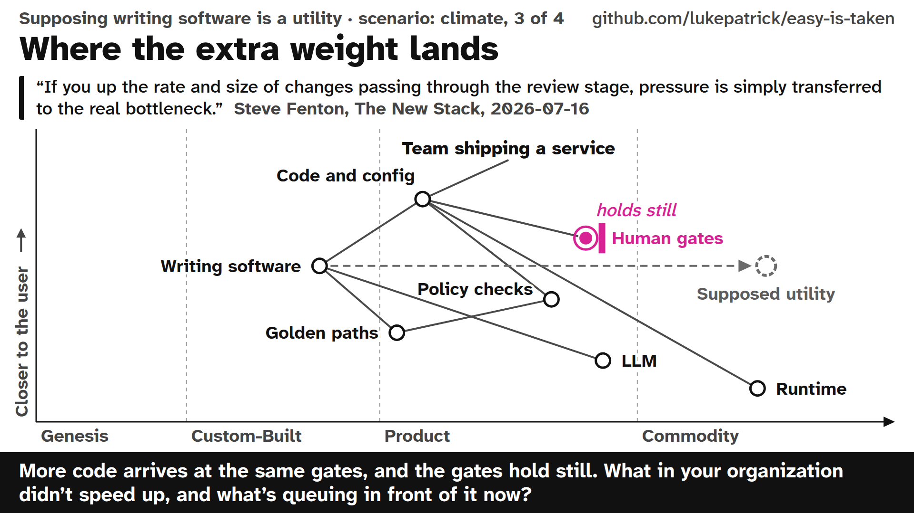

More code arrives at the same gates, and the gates hold still. What in your organization didn’t speed up, and what’s queuing in front of it now?

Steve Fenton makes a related point about software delivery in general (["AI hasn't shifted the bottleneck from coding to code review"](https://thenewstack.io/ai-code-bottleneck-myth/), 2026-07-16):

> "If you up the rate and size of changes passing through the review stage, pressure is simply transferred to the real bottleneck."

He writes about review and deployment without mentioning platforms, and works at Octopus Deploy, which sells deployment software. Connecting his line to this map is my reading.

**4. Adjust, or fall apart?** ([`04-adjust-or-fall-apart.owm`](../deck/maps/04-adjust-or-fall-apart.owm))

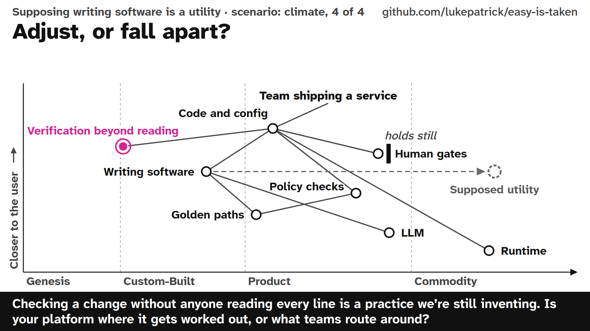

Checking a change without anyone reading every line is a practice we’re still inventing. Is your platform where it gets worked out, or what teams route around? Frame 05 below shows four such practices.

## Frames

Follow the red highlight; tap an image to open it full size.

### 00 Before

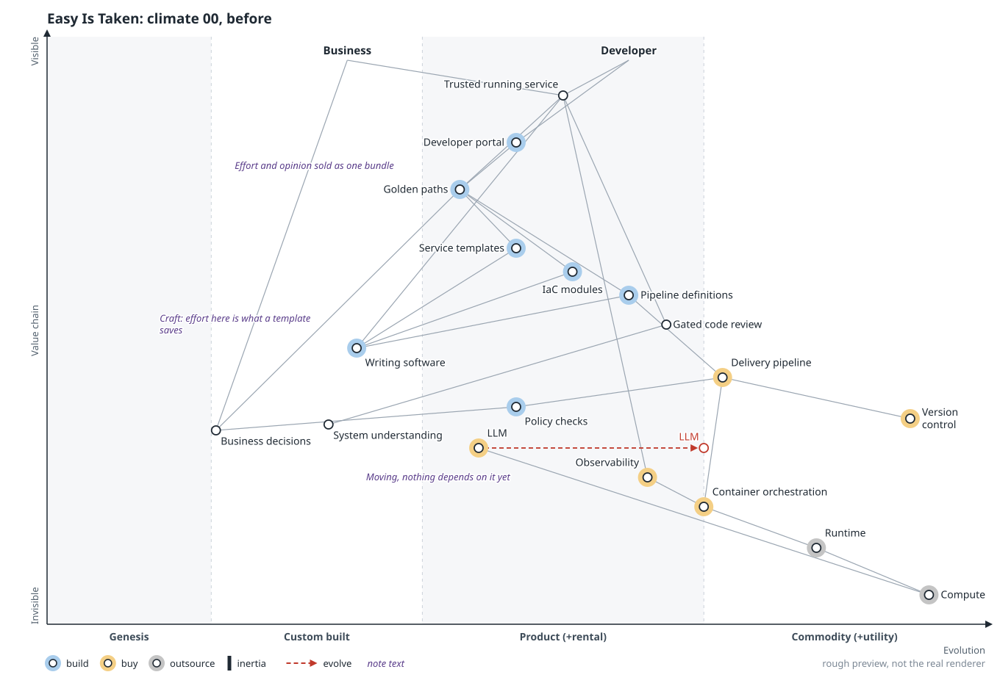

**Move:** none. Writing is craft and expensive, so a template has a price. A golden path sells effort you did not spend and decisions you did not make as one thing.

**Question it leaves:** When a team picked your golden path, which of those two were they paying for?

### 01 Writing moves

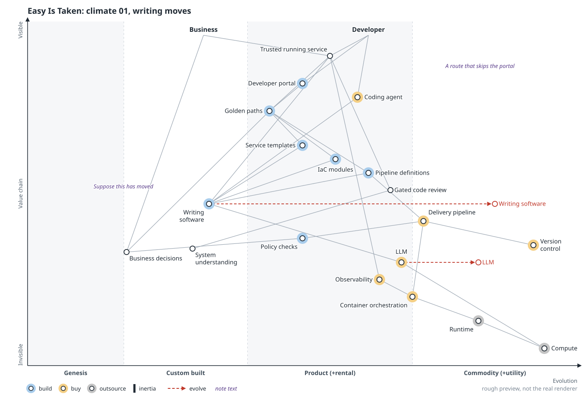

**Move:** suppose `Writing software` moves toward utility, with the LLM beneath it. A `Coding agent` opens a second route to a running config that touches nothing inside the fence.

**Question it leaves:** How much of what you ship was priced on the effort to write it?

### 02 The bundle splits

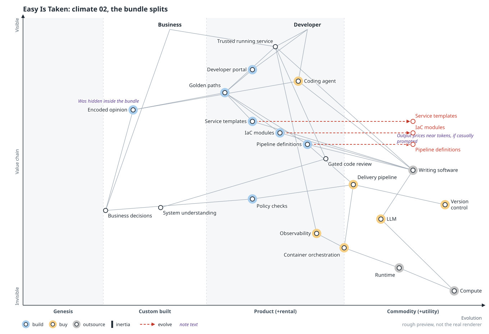

**Move:** the golden path comes apart. Its output (templates, modules, pipelines) gets arrows right. `Encoded opinion` appears far left: it was always in there, and now it can be seen. A link from the coding agent to it spoils the comfort, because an agent can read a file.

**Question it leaves:** If your opinion fits in a file your agents can read, what else is the platform for?

### 03 Jevons

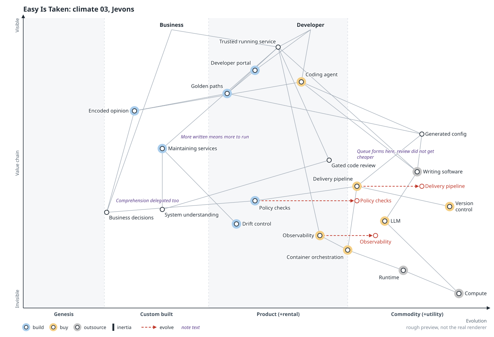

**Move:** the output merges into `Generated config`. `Maintaining services` and `Drift control` appear, and the pipeline, policy checks and observability are pulled right by volume. The load on the platform grows while the part worth owning shrinks.

**Question it leaves:** More code arrives at the same gates, and the gates hold still. What in your organization didn’t speed up, and what’s queuing in front of it now?

### 04 Inertia

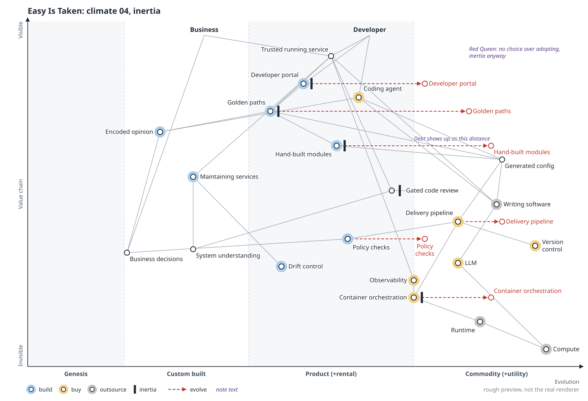

**Move:** inertia bars on the portal, golden paths, gated code review and container orchestration. `Hand-built modules` sits at its old position; its distance from `Generated config` is what Wardley recently called evolutionary debt. Nobody has to be foolish: good usage numbers are what past success looks like from inside.

**Question it leaves:** Which number on your platform dashboard would look fine right up to the day nobody needed the thing it measures?

### 05 Co-evolution

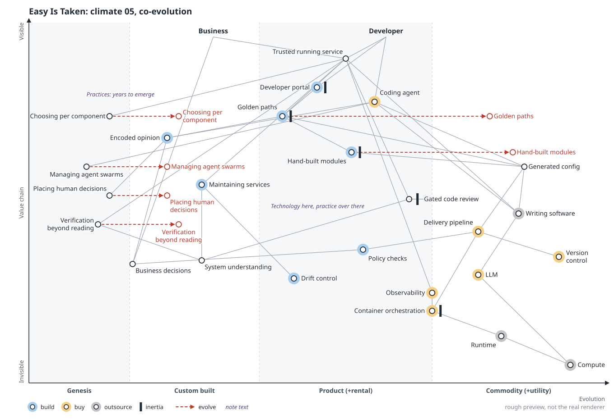

**Move:** four practices appear far left, each drawn from something Wardley wrote: choosing per component, managing agent swarms, placing human decisions, and verification beyond reading. Writing software sits far right. A platform team may be running production while the safe way to work is still unwritten.

**Question it leaves:** Is your platform where these practices are being worked out, or where they get blocked?

### 06 Adjacent unexplored

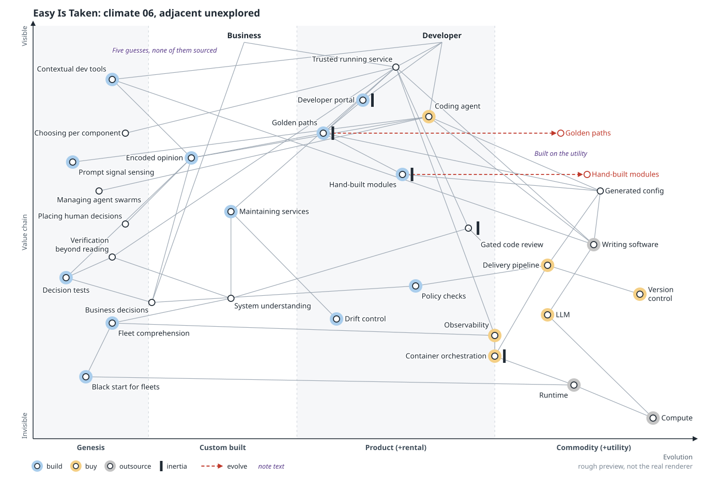

**Move:** five guesses appear in genesis: contextual dev tools, prompt signal sensing, decision tests, fleet comprehension, and black start for fleets. A utility makes affordable what nobody could justify before; the frame is a prompt for better guesses.

**Question it leaves:** What can you afford now that you could never have got funded when writing was expensive?

### 07 Still moving

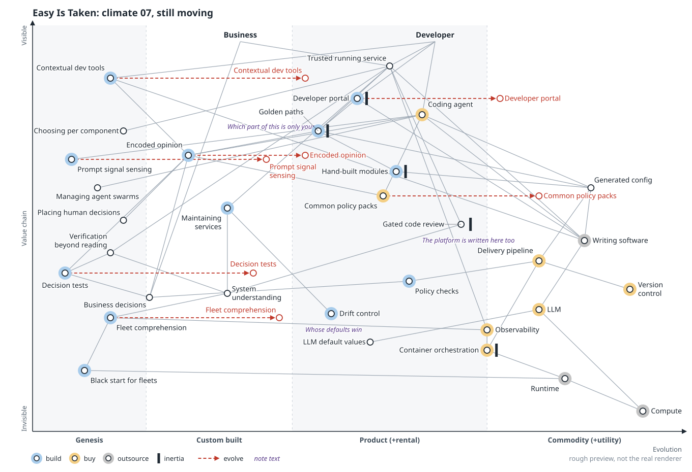

**Move:** `Encoded opinion` gets an arrow right. `Common policy packs` appears in product and `LLM default values` under the LLM. The portal now depends on writing software too, and the genesis guesses get arrows. Whatever the room decides is left, the arrows are still running.

**Question it leaves:** Which part of your opinion is only yours, and how would you tell?

## Sources

- Borrowed from Simon Wardley, with IDs from my source ledger: practice taking years (C09), evolutionary debt (Q04, a recent term), and the four practices in frame 05 (V03, P16, H07, and G05 or H12)
- `.owm` sources:
  [`00-before.owm`](../maps/candidates/climate/00-before.owm) ·
  [`01-writing-moves.owm`](../maps/candidates/climate/01-writing-moves.owm) ·
  [`02-bundle-splits.owm`](../maps/candidates/climate/02-bundle-splits.owm) ·
  [`03-jevons.owm`](../maps/candidates/climate/03-jevons.owm) ·
  [`04-inertia.owm`](../maps/candidates/climate/04-inertia.owm) ·
  [`05-coevolution.owm`](../maps/candidates/climate/05-coevolution.owm) ·
  [`06-higher-order.owm`](../maps/candidates/climate/06-higher-order.owm) ·
  [`07-still-moving.owm`](../maps/candidates/climate/07-still-moving.owm)

[All scenarios](README.md)
