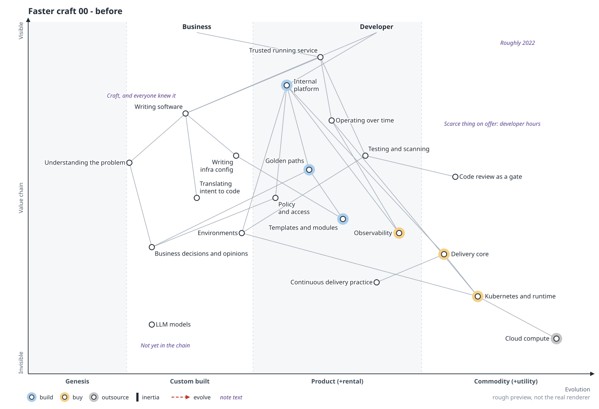
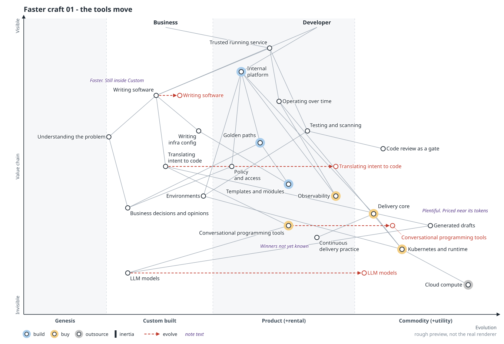
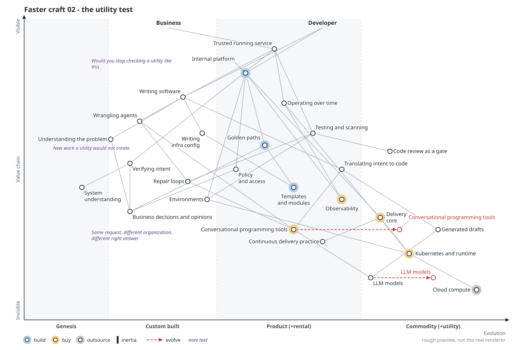
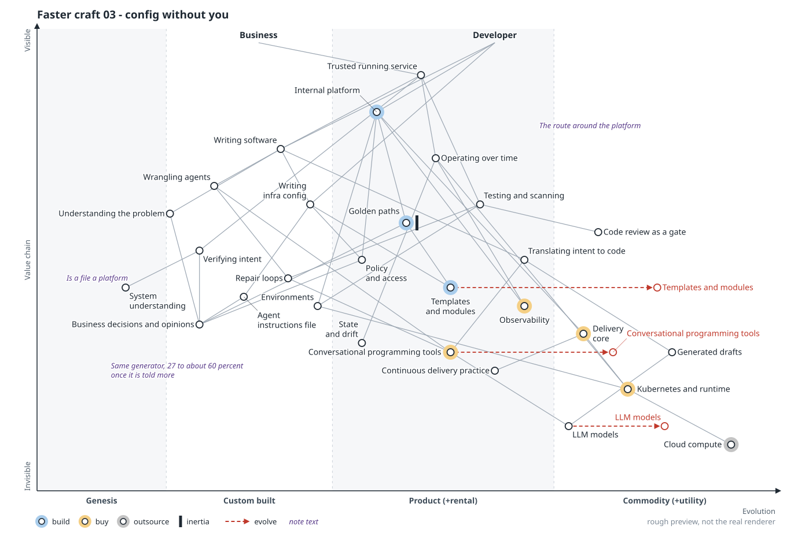
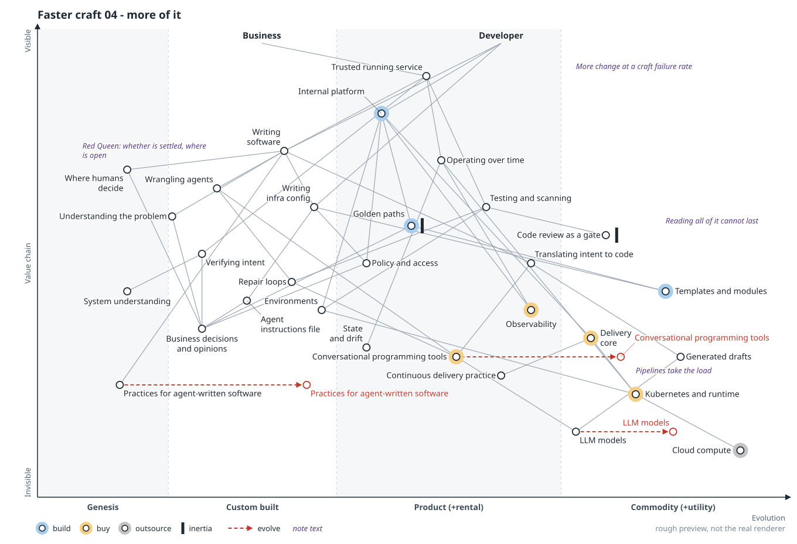
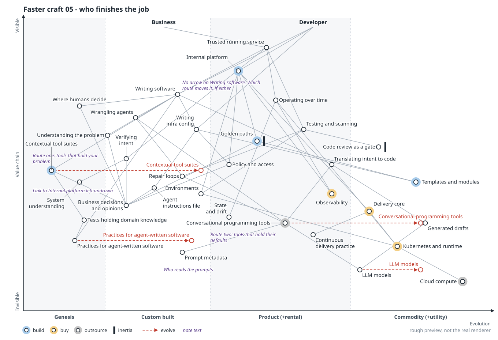

# Dissent: faster craft

> **Starting point:** I read Steve Fenton's ["Easy is taken"](https://stevefenton.co.uk/blog/2026/10/easy-is-taken/) as writing software becoming a utility. That's my supposition; neither Fenton nor Wardley says it. This scenario pushes back: the tools moved, the activity barely did. [All six scenarios](README.md).

**In the talk:** what’s left: *The craft, done faster.* The tools moved a long way. The work moved a little. A carpenter with a nail gun is still a carpenter, and nobody has industrialized the craft. **What are you building on as if it were already a utility?** (closing slide)

**Lens:** a dissent from the supposition. Six frames, `00` to `05`.

## Thesis

The tools under writing software moved a long way. The activity moved a little.

Wardley says LLMs are heading to utility. Fenton argues that a casually prompted draft is worth about the cost of its tokens, unless someone put deep skill or knowledge into it. Going from a need to software someone will trust in production is still craft, done faster. "Craft" is Wardley's word; concluding that writing software isn't a utility is this scenario's step, and he doesn't take it.

If that holds, no stable layer has arrived to build on. A craft is running at machine speed, its output arrives faster than anyone can inspect it, and somebody has yet to industrialize it.

Two tests, both judgment, sit behind the placements. With a utility you stop checking what's inside it, so the first asks whether people have stopped. The second asks whether the same request has the same right answer from any supplier, in any organization.

This is the reading a room of platform engineers will want to hear, because it keeps their jobs intact, and that alone is a reason to distrust it.

## Frames

Follow the red highlight; tap an image to open it full size.

### 00 Before

**Move:** none. Around 2022: delivery and runtime on the right, a platform of tools, templates and golden paths in the middle, writing software on the left. The platform's visible offer was saved hours.

**Question it leaves:** What did your platform sell: the hours saved, or something the template only stood for?

### 01 The tools move

**Move:** LLMs head for utility, conversational programming tools appear in product, `Translating intent to code` moves well right, and `Generated drafts` arrive in commodity. `Writing software`, above them all, stays in custom. Speed is a different axis from evolution.

**Question it leaves:** On your own map, which components moved, and which only got faster?

### 02 The utility test

**Move:** run the two tests. New work appears on the left that a utility would never create: wrangling agents, repair loops, verifying intent, and understanding a system nobody typed. This is the central exhibit and the most open to attack, since new work around a utility is also how co-evolution looks.

**Question it leaves:** What would you have to stop checking before you'd call writing software a utility?

### 03 Config without you

**Move:** a link runs from the developer straight to `Writing infra config`, around the platform. Templates and modules head for commodity, and golden paths pick up inertia. An agent instructions file becomes a rival home for opinion, and writing infra config now depends on policy and access. The template was the cheap part; what's left is whatever can still say no.

**Question it leaves:** When a developer generates the config without you, which of your platform's opinions can still stop it?

### 04 More of it

**Move:** Jevons and the Red Queen arrive. Code review gets inertia, since reading everything can't last (Wardley's point). Practices for agent-written software and `Where humans decide` appear far left. More use of a utility means more of something reliable; more use of a craft means more failures, more of them unread.

**Question it leaves:** At ten times the change and a craft's failure rate, what on your map gives way first?

### 05 Who finishes the job

**Move:** two routes by which writing software could still evolve, and no arrow on `Writing software`. On the left, contextual tool suites appear in genesis, fed by tests that hold domain knowledge (both Wardley's ideas). On the right, conversational programming tools move toward outsourcing, with prompt metadata pooling at the vendor. Whoever carries the craft to utility sets the defaults.

**Question it leaves:** Who is turning your craft into engineering, and if nobody in your organization is, whose tools and values will?

## Sources

- Borrowed from Simon Wardley, with IDs from my source ledger: "a faster craft" (C04), why it stays craft and tools specific to the context (C03, K02), tests that hold domain knowledge (K01), reading code not lasting (G05, G06), and prompt metadata as a signal (G07)
- `.owm` sources:
  [`00-before.owm`](../maps/candidates/dissent-faster-craft/00-before.owm) ·
  [`01-the-tools-move.owm`](../maps/candidates/dissent-faster-craft/01-the-tools-move.owm) ·
  [`02-the-utility-test.owm`](../maps/candidates/dissent-faster-craft/02-the-utility-test.owm) ·
  [`03-config-without-you.owm`](../maps/candidates/dissent-faster-craft/03-config-without-you.owm) ·
  [`04-more-of-it.owm`](../maps/candidates/dissent-faster-craft/04-more-of-it.owm) ·
  [`05-who-finishes-the-job.owm`](../maps/candidates/dissent-faster-craft/05-who-finishes-the-job.owm)

[All scenarios](README.md)
