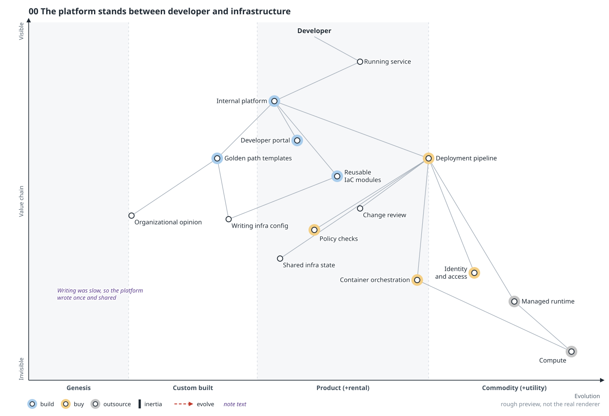
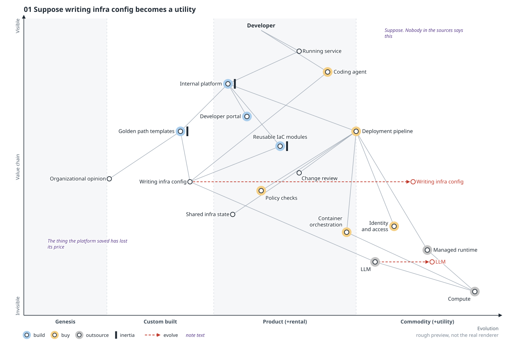
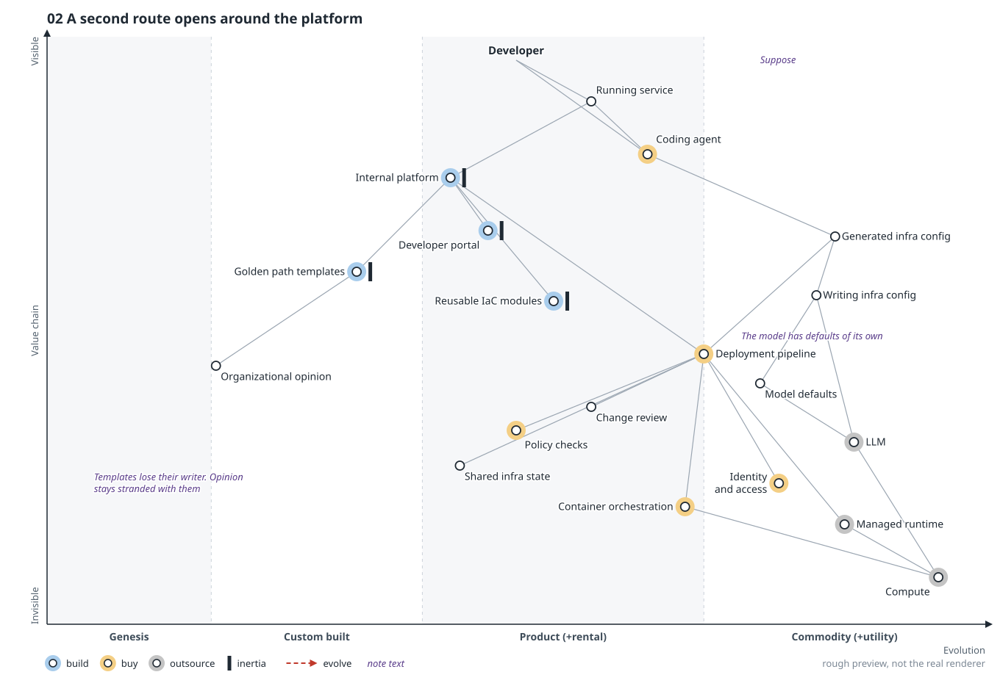
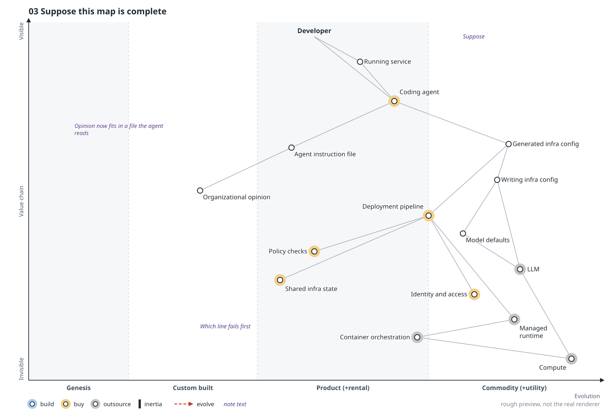
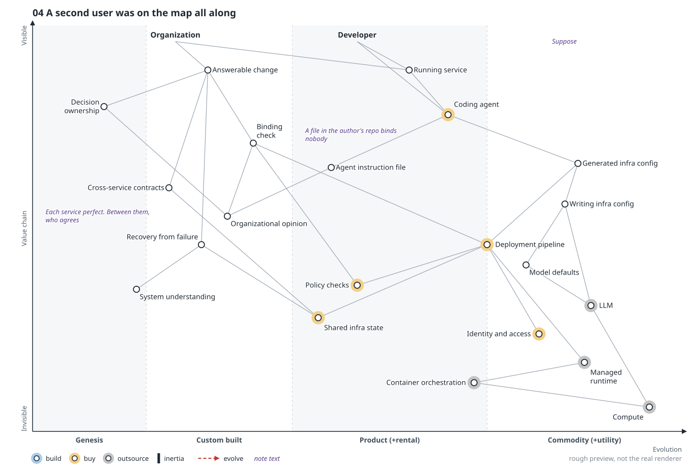
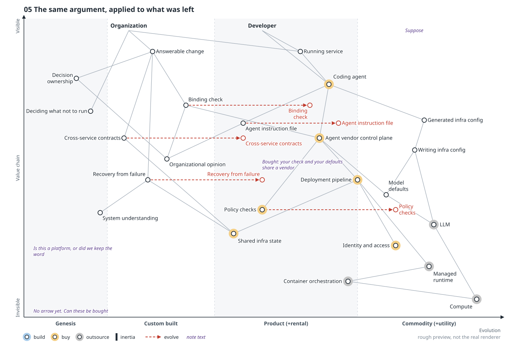

# Dissent: no platform

> **Starting point:** I read Steve Fenton's ["Easy is taken"](https://stevefenton.co.uk/blog/2026/10/easy-is-taken/) as writing software becoming a utility. That's my supposition; neither Fenton nor Wardley says it. This scenario pushes it further than any source goes, on purpose. Nothing here is a forecast. [All six scenarios](README.md).

**In the talk:** what’s left: *The work between people.* Push the supposition all the way and the platform leaves the map for anything one team can do alone. What stays is the work between teams. **When the config is perfect and the outage happens anyway, whose name is on it?** (closing slide; the question is this scenario’s punchline)

**Lens:** follow vibe-coded infra config to its end. Six frames, `00` to `05`.

## Thesis

The platform does leave the map, for anything one small team can do alone. Read this way, a platform was a shared store of expensive writing. When writing is free the store has nothing to protect, and even captured opinion fits in a file the agent reads.

What stays is work between people: agreements across services, checks the author can't edit, and a named owner when things fail. Whether that deserves the word "platform" is left open.

One rule: from frame 01 on, the generator never writes a bad line, because rescuing the platform with today's defects only buys time. Until frame 04 the only anchor is the developer, the strongest setup for disappearance and the scenario's largest weakness.

## Frames

Follow the red highlight; tap an image to open it full size.

### 00 The platform stands between developer and infrastructure

**Move:** none. Writing infra config is craft, so the platform writes it once and shares it through templates and modules: a cache in front of a slow function, with the organization's opinion riding inside.

**Question it leaves:** If your platform went away for a week, who would complain first?

### 01 Suppose writing infra config becomes a utility

**Move:** `Writing infra config` and the LLM move toward utility. A `Coding agent` enters with a direct line from the developer. The internal platform, templates and modules take inertia. What the cache saved has lost its price.

**Question it leaves:** Which parts of your platform exist only because writing the config by hand was slow?

### 02 A second route opens around the platform

**Move:** `Generated infra config` substitutes for templates and modules (no arrow: substitution differs from evolution) and reaches the pipeline without touching the platform. The organization's opinion is stranded on the old path, and `Model defaults` fills the gap: a golden path nobody in your organization chose.

**Question it leaves:** If your developers stopped using the platform tomorrow, how long before you would know?

### 03 Suppose this map is complete

**Move:** the internal platform, portal, templates, modules and change review leave the map. An `Agent instruction file` holds the opinion, and orchestration stays outsourced behind the managed runtime. Nothing is drawn as broken; for a small team the scenario judges this plausible.

**Question it leaves:** Point at the line on this map that fails first in your organization.

### 04 A second user was on the map all along

**Move:** `Organization` joins as a second anchor, needing `Answerable change`, with decision ownership, a binding check, cross-service contracts, recovery and system understanding beneath it. `Shared infra state` sat on frame 03 unnoticed. Two perfect configs can still disagree, a file in the author's repo binds nobody, and nobody can prompt an owner.

**Question it leaves:** When the config is perfect and the outage happens anyway, whose name is on it?

### 05 The same argument, applied to what was left

**Move:** the residue gets arrows: binding check, contracts, recovery, instruction file and policy checks. An `Agent vendor control plane` enters between agent and pipeline, and `Deciding what not to run` enters with no arrow. Checks and contracts are products in waiting, and the party best placed to sell them already sits in the developer's path.

**Question it leaves:** If all of this can be bought, what would you refuse to buy, and would you still call it a platform?

## Sources

- `.owm` sources:
  [`00-before.owm`](../maps/candidates/dissent-no-platform/00-before.owm) ·
  [`01-writing-moves.owm`](../maps/candidates/dissent-no-platform/01-writing-moves.owm) ·
  [`02-second-route.owm`](../maps/candidates/dissent-no-platform/02-second-route.owm) ·
  [`03-no-platform.owm`](../maps/candidates/dissent-no-platform/03-no-platform.owm) ·
  [`04-second-anchor.owm`](../maps/candidates/dissent-no-platform/04-second-anchor.owm) ·
  [`05-residue-moves.owm`](../maps/candidates/dissent-no-platform/05-residue-moves.owm)

[All scenarios](README.md)
