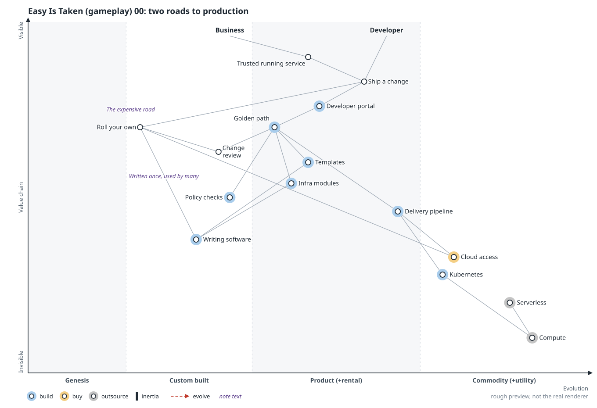
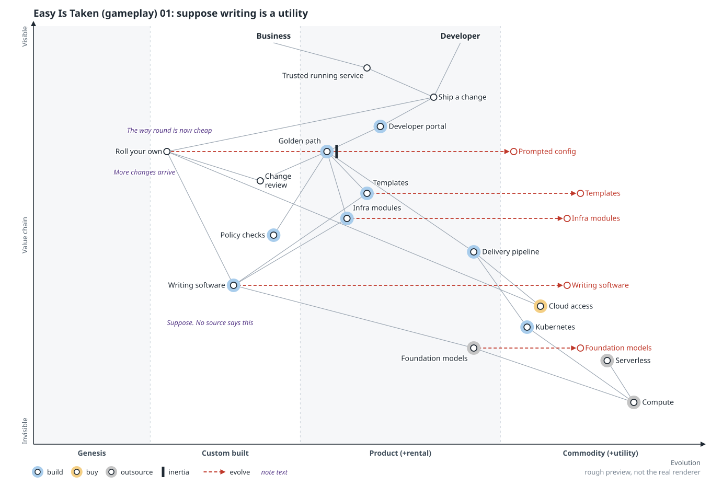
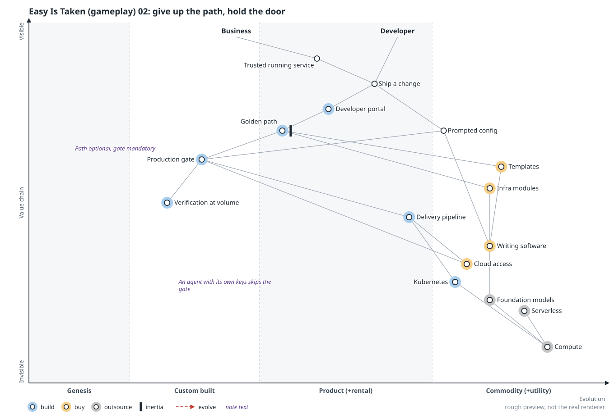
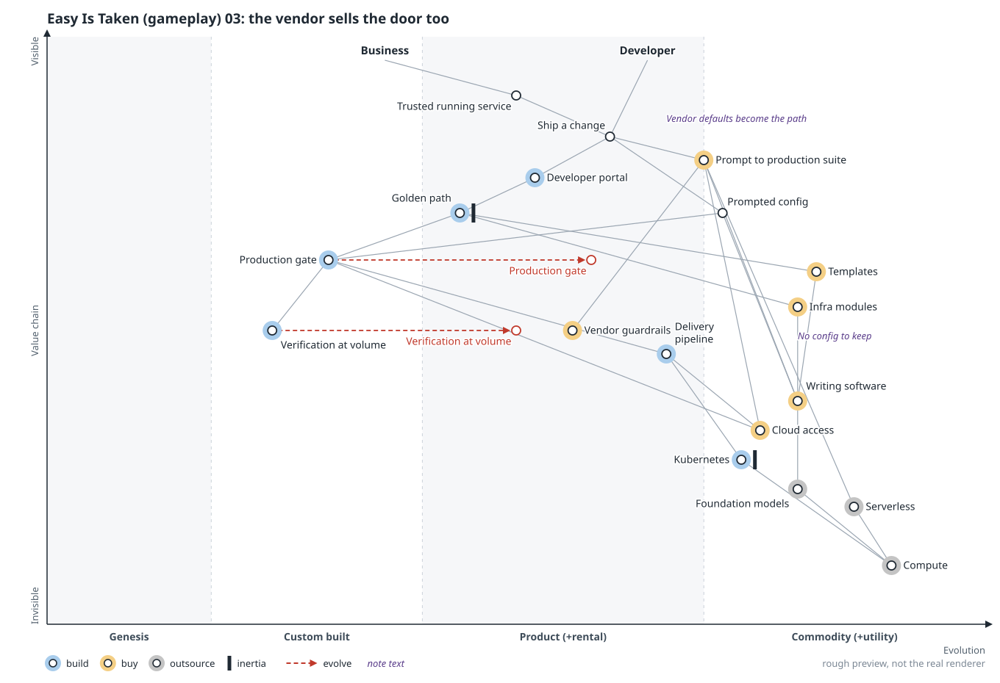
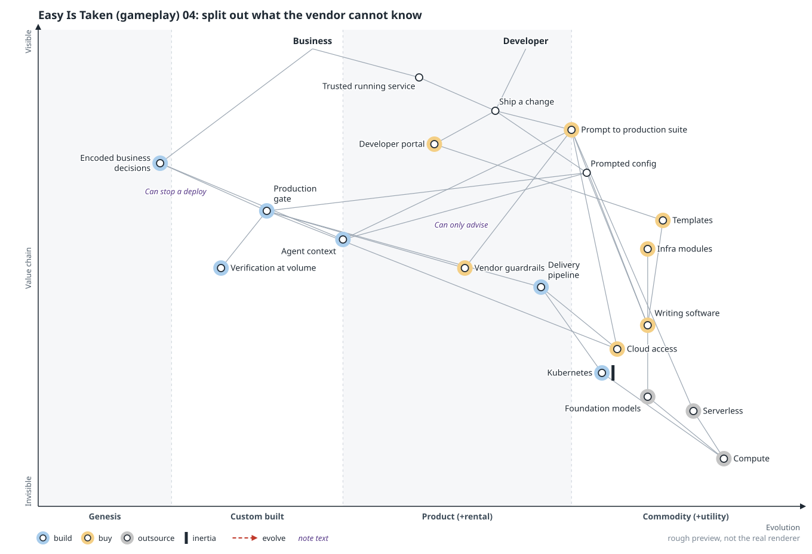
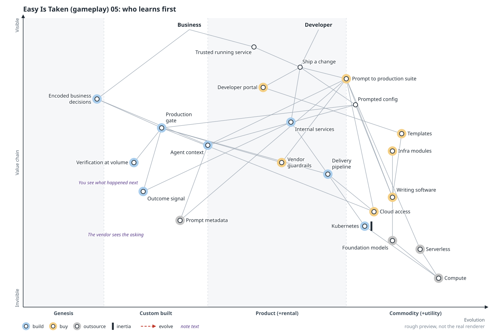
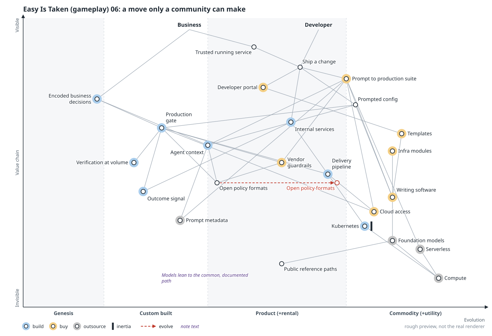
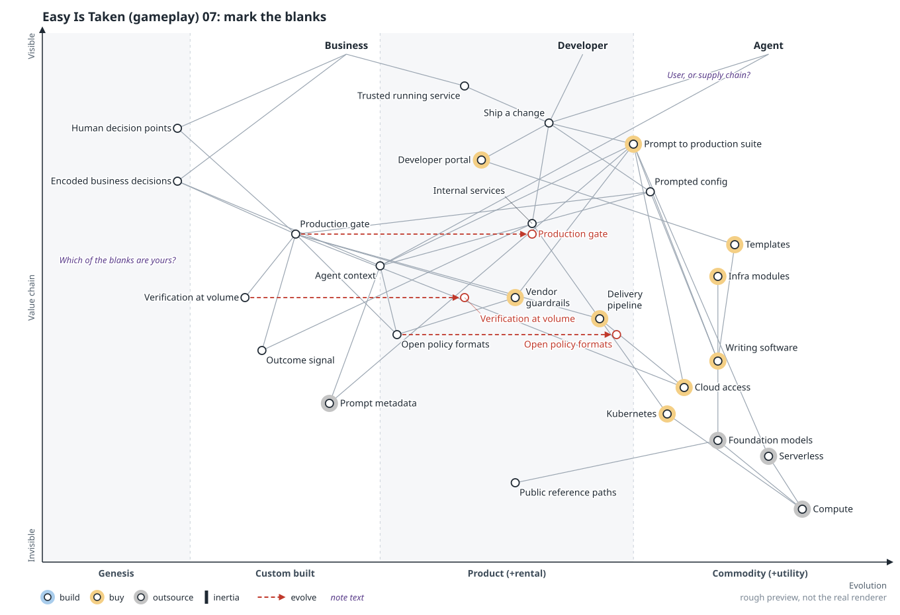

# Scenario: gameplay

> **Starting point:** I read Steve Fenton's ["Easy is taken"](https://stevefenton.co.uk/blog/2026/10/easy-is-taken/) as writing software becoming a utility. That's my supposition; neither Fenton nor Wardley says it. This scenario runs with it and works out the moves. [All six scenarios](README.md).

**In the talk:** what’s left: *Whatever your team still chooses to build.* Teams stayed on the platform partly because the way round cost more. Suppose a prompt makes it cheap. Now someone else is watching too. **Who learns first what your teams keep asking for: you, or whoever sells them the agent?** (closing slide; the question is frame 05’s, [Who learns first](#05-who-learns-first))

**Lens:** gameplay and doctrine. Eight frames, `00` to `07`, played as turns. The order is logic and carries no dates.

## Thesis

A platform kept its users partly because the way round it cost more than the way through. Suppose a prompt makes the way round cheap. The platform is then in a contested game, and a larger player can sell the platform's own company most of the ground it retreats to. The question is what you can hold, and at what cost.

No map has a component called platform: the platform is whatever set a team still chooses to build, and the last frame leaves it blank. Frames 02, 04 and 05 could all be read as a team protecting itself in the vocabulary of value.

Blue, yellow and gray halos in the previews mark build, buy and outsource.

## Frames

Follow the red highlight; tap an image to open it full size.

### 00 Two roads to production

**Move:** none; this is the board. A developer reaches production through the platform or around it by rolling their own. Both rest on slow, skilled writing, and the platform writes once for many.

**Question it leaves:** On your own map, who was the platform competing with before anyone had an agent?

### 01 Suppose writing is a utility

**Move:** climate, which nobody plays. Writing software moves right, and rolling your own becomes prompted config. More changes arrive at review, and the golden path picks up inertia. Everything the platform built still works; only the price of the alternative changed.

**Question it leaves:** If the way round your platform is cheap, what were your developers getting by staying on it?

### 02 Give up the path, hold the door

**Move:** the platform stops competing on how a change is made and controls whether it may enter production. The golden path turns optional. Policy checks and change review merge into a gate every route must pass.

**Question it leaves:** What on your path to production can a prompt not grant itself?

### 03 The vendor sells the door too

**Move:** agent vendors move down toward deployment and hyperscalers up toward the agent. One product runs from prompt to runtime, guardrails included, and its defaults become the organization's golden path.

**Question it leaves:** Which part of your door would you refuse to buy?

### 04 Split out what the vendor can't know

**Move:** the golden path splits. Its output has already gone right; its opinion stays left as encoded business decisions. Those reach the agent as context, which only advises, and the gate as checks, which can stop a deploy. The gate's generic work goes to the vendor.

**Question it leaves:** If a decision can't stop a deploy, has your platform captured it?

### 05 Who learns first

**Move:** both sides run the same sensing play. The platform leaves the way round open where the blast radius is small and turns what recurs into internal services. The vendor sees prompts across every customer; the platform sees what shipped, broke and cost in one organization.

**Question it leaves:** Who finds out first what your developers keep asking for, you or the company selling them the agent?

### 06 A move only a community can make

**Move:** the most speculative frame. If platform teams make the layer that carries opinion an open format, no vendor owns it and decisions stay portable. Published reference paths may also steer every model's defaults.

**Question it leaves:** Which of your opinions would you publish so every model learns them, and which would you keep?

### 07 Mark the blanks

**Move:** the room's turn. What the supposition settled keeps its marks; everything contested is blank. `Agent` appears as a third anchor, with a note asking whether it is a user at all. Three arrows remain, so the board is still moving.

**Question it leaves:** Mark the blanks for your own organization: what would you call the set you'd still build?

## Sources

- `.owm` sources:
  [`00-before.owm`](../maps/candidates/gameplay/00-before.owm) ·
  [`01-the-way-round.owm`](../maps/candidates/gameplay/01-the-way-round.owm) ·
  [`02-hold-the-door.owm`](../maps/candidates/gameplay/02-hold-the-door.owm) ·
  [`03-prompt-to-production.owm`](../maps/candidates/gameplay/03-prompt-to-production.owm) ·
  [`04-what-a-vendor-cannot-know.owm`](../maps/candidates/gameplay/04-what-a-vendor-cannot-know.owm) ·
  [`05-who-sees-first.owm`](../maps/candidates/gameplay/05-who-sees-first.owm) ·
  [`06-open-the-format.owm`](../maps/candidates/gameplay/06-open-the-format.owm) ·
  [`07-your-move.owm`](../maps/candidates/gameplay/07-your-move.owm)

[All scenarios](README.md)
