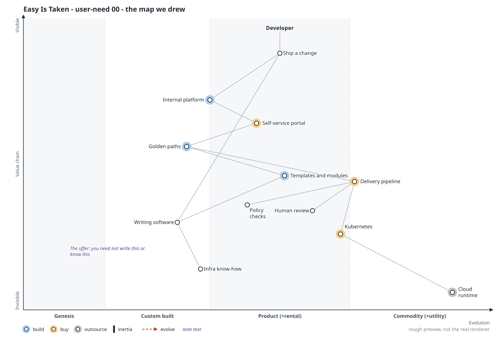
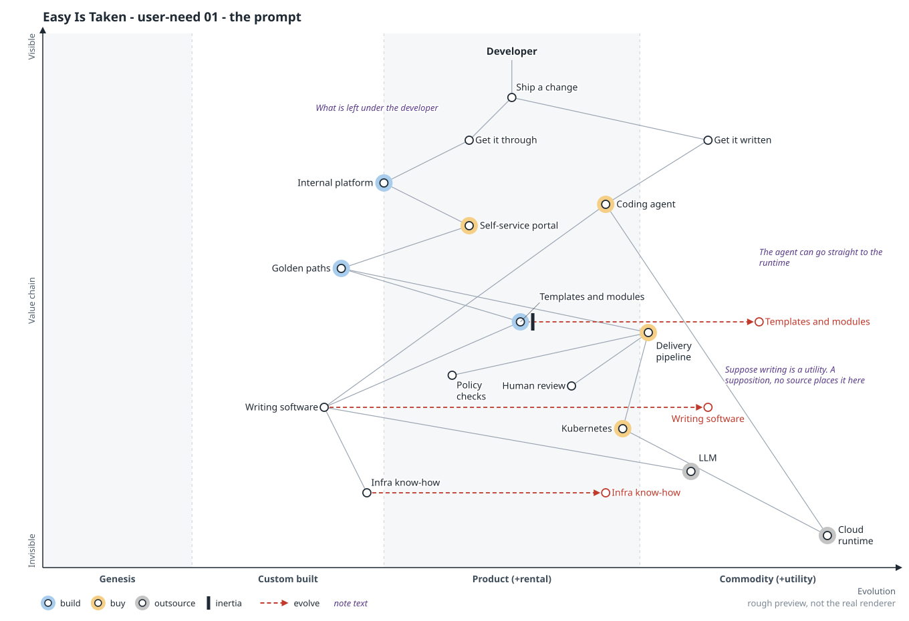
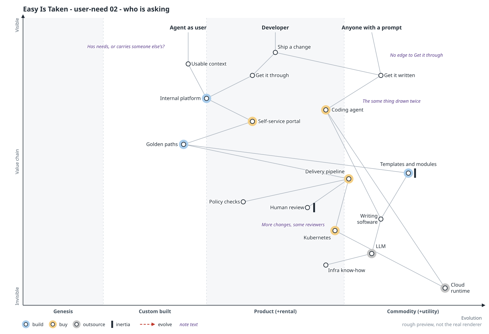
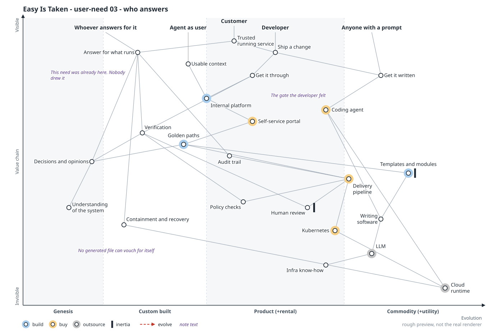
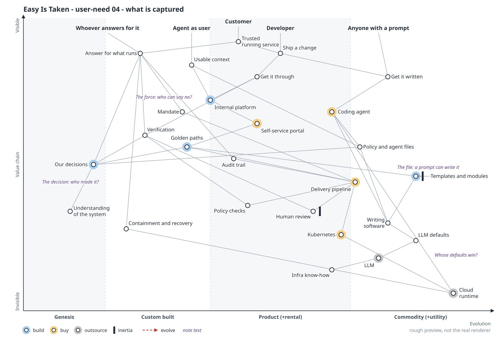
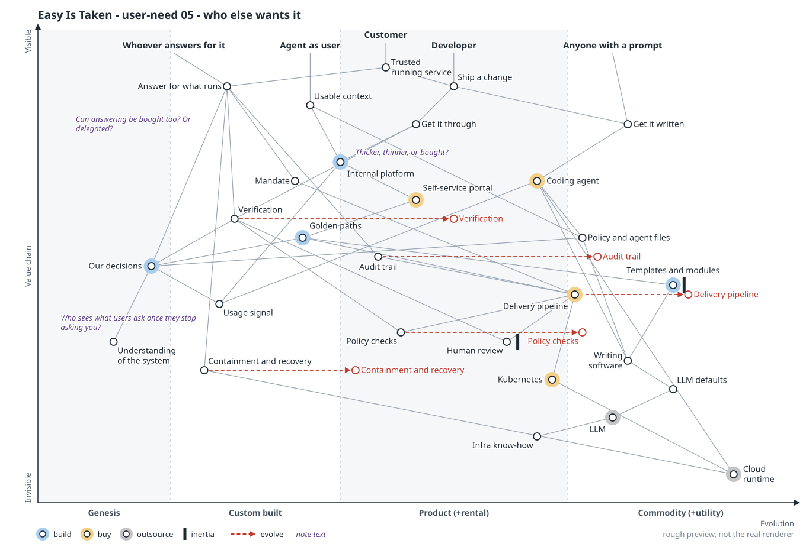

# Scenario: user need

> **Starting point:** I read Steve Fenton's ["Easy is taken"](https://stevefenton.co.uk/blog/2026/10/easy-is-taken/) as writing software becoming a utility. That's my supposition; neither Fenton nor Wardley says it. [All six scenarios](README.md).

**In the talk:** what’s left: *Answering for what runs.* Our maps draw one user, the developer. Suppose a prompt meets half of what they need. The other half belongs to someone we never drew. **If your platform vanished tomorrow and your teams kept shipping, who would complain first?** (closing slide)

**Lens:** start from the user at the top of the map. Six frames, `00` to `05`.

## Thesis

Platform maps draw one user, the developer, who needs a change written and got through. Suppose writing goes to utility. A prompt meets the first half, so a platform anchored only on the developer has little left to offer. The second half belongs to whoever answers for what runs. That person was never drawn as a user, though much of the platform already served them.

Frame 04 takes "captured decisions" apart and finds only part of it scarce. Frame 05 shows the answering chain evolving too. The room gets a way to find its own anchor and no verdict on what sits beneath it.

## Frames

Follow the red highlight; tap an image to open it full size.

### 00 Before: the map we drew

**Move:** none. One anchor, one need, and a chain that tells the developer they need not write this or know this. The platform rests on two scarce items near the bottom, `Writing software` and `Infra know-how`.

**Question it leaves:** Who did we say the platform was for?

### 01 The prompt

**Move:** suppose `Writing software` evolves toward utility, taking `Templates and modules` and generic `Infra know-how` with it. A `Coding agent` opens a route to the runtime that skips the platform. The need splits into `Get it written` and `Get it through`, and only the first moved.

**Question it leaves:** If your developers could reach production with a prompt today, which of your platform's features would they still come to?

### 02 Who is asking

**Move:** `Anyone with a prompt` arrives as an anchor, linked to `Get it written` only. `Agent as user` is an anchor on trial, with `Usable context` beneath it. `Human review` gets inertia.

**Question it leaves:** Count everything that changed production last month: is each of them on your map?

### 03 Who answers

**Move:** `Customer` appears above everything, needing a `Trusted running service`. `Whoever answers for it` arrives with a chain beneath: verification, an audit trail, decisions and opinions, understanding of the system, and containment and recovery. Nothing moves, but policy checks, human review and the delivery pipeline gain a second parent. This is the scenario's most exposed step: it infers the second user from the fact that many platforms are mandated.

**Question it leaves:** If your developers kept shipping and your platform vanished tomorrow, who would complain first?

### 04 What is captured

**Move:** `Decisions and opinions` splits three ways. `Our decisions` stays far left. `Policy and agent files`, the written form, sits in commodity with the rest of writing. `Mandate`, the force behind the file, is new. `LLM defaults` appears as a rival source of opinion. The file is cheap, the decision behind it is scarce, and nobody can prompt the mandate.

**Question it leaves:** Pick one decision your platform holds, and tell me who made it and who can say no.

### 05 Who else wants it

**Move:** the answering chain starts to evolve. Audit trail, policy checks, delivery pipeline, verification, and containment and recovery all get undated arrows right, each a guess. `Usage signal` appears, fed by whichever route the work takes. Nothing gets a settled place.

**Question it leaves:** Which part of this could you buy, and who sees what your users ask for once they stop asking you?

## Sources

- `.owm` sources:
  [`00-before.owm`](../maps/candidates/user-need/00-before.owm) ·
  [`01-the-prompt.owm`](../maps/candidates/user-need/01-the-prompt.owm) ·
  [`02-who-is-asking.owm`](../maps/candidates/user-need/02-who-is-asking.owm) ·
  [`03-who-answers.owm`](../maps/candidates/user-need/03-who-answers.owm) ·
  [`04-what-is-captured.owm`](../maps/candidates/user-need/04-what-is-captured.owm) ·
  [`05-who-else-wants-it.owm`](../maps/candidates/user-need/05-who-else-wants-it.owm)

[All scenarios](README.md)
